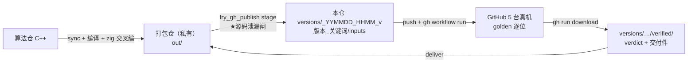

# fry_p_3d_rip_261108_github_simulation_build —— 模拟仿真 SDK 多平台真机验收仓

> ★461 建。产品：模拟仿真 SDK（六视图 + 仿真 GLB，整条流程 C++）；打包仓：`fry_p_3d_rip_261030_simulation_build_dll`。

## 这个仓是什么

**只放编译好的二进制 + 验收脚本，不放算法源码**的公开仓。用途只有一个：借 GitHub 的真机（Linux x64 / Linux ARM64 / macOS Apple 芯片 / macOS Intel / Windows）
把打包仓交叉编译出来的库**在目标平台上真跑 golden**，跑过了才算交付件。

> 一句话：**算法住算法仓，编译住打包仓（私有），本仓只负责「在别人的机器上验、把结论带回来、按日期留档」。**
> *Algorithm in the algorithm repo, builds in the private packaging repo; this public repo only verifies binaries on real machines and keeps dated history.*

## 一键

| 怎么做 | 命令 |
|---|---|
| 双击 | `fry_gh_publish.bat`（= `all`：stage → push → ci → record → release → deliver） |
| 只看历史 | `fry_gh_publish.bat status` |
| 分步 | `fry_gh_publish.bat stage` / `push` / `ci` / `record` / `release` / `deliver`（`--version-dir` 默认最新） |
| 算法仓界面 | 工作台「HS500 GitHub多平台验收」（输入文件夹里放 `gh_job.json`） |

前提：本机 `gh auth login` 过；**跑之前把本仓切成 public**（私有仓的 macOS 机器按分钟计费），跑完可以切回 private。

## 目录

| 路径 | 作用 |
|---|---|
| `versions/_YYMMDD_HHMM_v<版本>_<关键词>/` | 一个版本一个目录（历史全留，回退直接拿）：`manifest.json`（版本 / 算法指纹 / 每个输入的 sha256 / 平台）、`inputs/`（推上来的二进制）、`verified/`（CI 带回的 verdict + 交付件）、`release_download/` |
| `versions/history.json` | 所有版本目录的状态（staged / verified / failed）与各平台结论 |
| `ci/workflows/fry_verify.yml` | ★工作流**正本**（`fry_gh_publish` push 前复制到 `.github/workflows/`，测试保证两份一致）：按 manifest 登记的平台生成矩阵 → 每台机器跑 `ci/fry_ci_target.py` → `ci/fry_ci_summary.py` 汇总 |
| `ci/fry_ci_target.py` | 一台机器上的验收：平台闸 → 输入 sha256 闸 → 真跑（判据全部来自打包仓已有的冒烟，不另立）→ `verdict.json` |
| `ci/fry_ci_summary.py` | 每个登记的平台都必须有结论且 ✓（少一台 = 红） |
| `ci/product.json` | 本仓是哪个产品（加网 / 仿真），对应哪个打包仓 |
| `tools/fry_gh_publish.py` | 本机一键（见上） |
| `tests/` | 本仓脚本自己的闸（`python -m pytest -q tests`） |

## 发布规则

- GitHub release 只上传交付件；但 GitHub 会**自动附带「Source code」压缩包**（= 本仓内容：二进制 + 脚本，不含算法源码）。
- 按约定：release 建好 → 下载回本机核对 sha256 → **默认删除 release 与 tag**（`--keep-release` 保留）。交付件始终在 `versions/<目录>/verified/` 里有一份。
